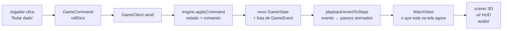

# Arquitetura do Battle Dice

Visão geral de como o jogo é montado hoje (outubro de 2026). Atualize este arquivo sempre que uma camada mudar.

## Camadas

```
frontend/src/
├── game/                    ← REGRAS DO JOGO (TypeScript puro, sem React, sem Three.js)
│   ├── domain/              ← estado, comandos, eventos, cada mecânica num arquivo
│   └── application/         ← "porta" entre a interface e quem manda no jogo (GameClient)
├── features/                ← APRESENTAÇÃO (React)
│   ├── match/               ← a partida
│   │   ├── model/           ← traduz eventos em animação (playback) e monta a MatchView
│   │   ├── hooks/           ← ligam o store e o áudio ao React (useMatch, useGameAudio, useMatchAudio)
│   │   ├── ui/              ← HUD, cartas, banners, menus de escolha (HTML/CSS)
│   │   │   └── abilities/   ← registro: o que "Usar" faz em cada habilidade que pergunta algo
│   │   ├── scene/           ← mundo 3D (React Three Fiber): tabuleiro, personagens, efeitos
│   │   ├── audio/           ← som sintetizado: efeitos, música, ambiente, falas
│   │   └── characters.ts    ← ficha visual de cada personagem (modelo, clipes, cores, efeitos)
│   ├── menu/                ← seleção de personagem com as intros
│   ├── settings/            ← configurações
│   └── lab/                 ← /laboratorio: testar efeitos visuais num personagem (só dev, fora do jogo)
├── app/                     ← rotas do Next.js (/, /jogar, /partida, /configuracoes, /laboratorio)
├── components/ui/           ← peças visuais genéricas (button, card, badge) no estilo shadcn/ui
└── lib/                     ← utilitários
```

**Regra de ouro:** `game/` não importa nada de `features/`. As regras do jogo não sabem que existe 3D, som ou React. Isso permite:

- testar todas as regras com vitest, sem navegador;
- levar o mesmo código para o servidor no futuro (o backend FastAPI vai validar as jogadas reimplementando ou espelhando essas regras);
- trocar a interface inteira sem tocar nas regras.

## O fluxo de uma jogada



1. **Comando** (`domain/commands.ts`): a intenção do jogador, como `rollDice`, `playCard`, `activateAbility` ou `discardCard`.
2. **Engine** (`domain/engine.ts` → `applyCommand`): função pura. Recebe o estado atual e o comando e devolve o **novo estado** mais os **eventos** do que aconteceu (`diceRolled`, `playerMoved`, `abilityBlocked`…). Nada é alterado no lugar; cada jogada gera um estado novo.
3. **GameClient** (`application/gameClient.ts`): a interface entre a tela e o "dono" do jogo. Hoje é o `LocalGameClient`, que roda a engine no navegador. No multiplayer será um `WebSocketGameClient` falando com a sala no FastAPI, **com o mesmo contrato**. A tela não vai perceber a diferença.
4. **Playback** (`features/match/model/playback/`): o estado novo chega de uma vez, mas a tela precisa *contar a história* em ordem: o dado gira, o boneco anda casa por casa, a armadilha dispara. Cada evento vira uma lista de `PlaybackStep { apply, durationMs }`, executados em fila pelo `matchStore`. Os handlers ficam um arquivo por tema (`turn.ts`, `cards.ts`, `fairy.ts`, `seraph.ts`…), e o `index.ts` junta tudo num mapa `evento → handler`.
5. **MatchView** (`model/matchView.ts`): o "estado da tela", ou seja, a posição mostrada de cada boneco, qual efeito está tocando e qual banner aparece. É ela que a cena 3D e o HUD leem. Fica atrás do `GameState` até o playback alcançá-lo.

### Por que separar GameState de MatchView?

O `GameState` diz **a verdade** (o jogador está na casa 42). A `MatchView` diz **o que o público vê agora** (o boneco ainda está andando, na casa 39). Sem essa separação, os bonecos se teletransportariam.

## Domínio: um arquivo por mecânica

| Arquivo | O que faz |
|---|---|
| `types.ts` | `GameState`, `Player`, `Tile`… os tipos centrais |
| `engine.ts` | `createGame`, `applyCommand`: o roteador de comandos |
| `turn.ts` | fim de turno, rodadas, energia por turno |
| `landing.ts` | o que acontece ao parar numa casa |
| `board.ts`, `boardGenerator.ts` | tabuleiro e presets (Treino, Torneio do Poder 200 casas) |
| `realms.ts`, `blessings.ts` | corredores do céu e do inferno, bênçãos |
| `cards.ts`, `cardPlay.ts`, `deck.ts`, `draft.ts`, `fusion.ts` | cartas, efeitos, compra, mão cheia, fusão |
| `abilities.ts` | carga e ativação das habilidades |
| `players.ts` | proteções (`aimWard`), oponentes no alcance |
| `<personagem>.ts` | mecânicas próprias: `fairy`, `kunoichi`, `berserker`, `seraph`, `seals`, `specters`, `arrowRain`, `cardGamble`, `transmutation`, `resurrection`, `hiddenTraps`, `newcomerAbilities` |
| `random.ts`, `dice.ts` | aleatoriedade injetável (para testes determinísticos) |

A aleatoriedade entra por `GameDependencies` (injeção de dependência), então os testes passam um dado "viciado" e conferem o resultado exato.

## Assets 3D

Padrão de nomes, pastas e como gerar os GLBs: [assets.md](assets.md).

## Testes e verificações

Rodar dentro de `frontend/` a cada mudança:

```bash
npm run typecheck && npm run lint && npm test && npm run build
```

Os testes vivem ao lado do código (`*.test.ts`). O grosso deles cobre `game/domain/`; `playback.test.ts` e `matchStore.test.ts` cobrem a camada de animação.
